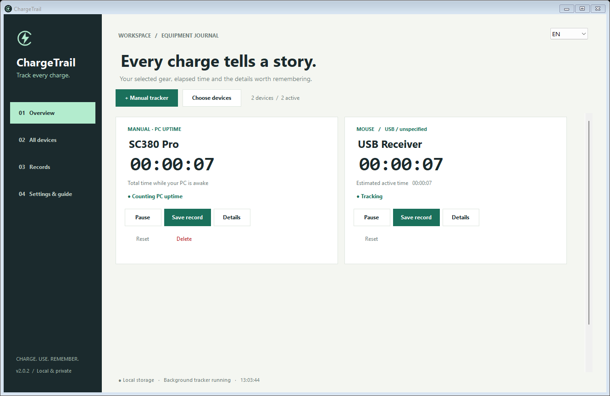

<p align="center"></p>
<h1 align="center">ChargeTrail</h1>
<p align="center">A runtime journal for your gear. Track a charge, save the result, remember the conditions.</p>
<p align="center"><a href="https://github.com/furkanyrtsvr/ChargeTrail/releases/latest">Download for Windows</a> · <a href="docs/README.tr.md">Türkçe kullanım rehberi</a></p>



## What is ChargeTrail?

Manufacturers advertise battery life, but your polling rate, connection mode, lighting and daily use can change the experience. ChargeTrail helps you keep a practical record of your own device tests: start after charging, let the tracker run in the background, then save the elapsed time when you observe that the battery has run out.

Keep separate cards for a mouse, keyboard or other equipment. Attach details such as **1000 Hz, 2.4 GHz, RGB off, mixed work and gaming** to each saved charge cycle. Reopen records to edit notes, review past results, or export them to CSV.

**ChargeTrail measures PC uptime, Windows device presence and estimated input activity. It cannot directly verify how long a wireless device is physically powered on, detect an empty battery, or measure battery capacity.** You mark the beginning and end of each charge test yourself.

## Download and run

1. Open [the latest release](https://github.com/furkanyrtsvr/ChargeTrail/releases/latest).
2. Download **ChargeTrail.exe**, or extract **ChargeTrail-windows-x64.zip**.
3. Run the EXE on **Windows 10/11, 64 bit**. It uses Windows' **.NET Framework 4.8**; no Python, .NET SDK or installer is required.
4. Pick **TR** or **EN** from the language selector. Your choice is saved.

Release files include SHA-256 checksums. Administrator access is not required.

## Your first charge test

1. Fully charge your equipment.
2. Open **All devices** and tick **Overview** next to the devices you want on your dashboard. **Identify mouse / keyboard** lets you move or type on a physical device to find and pin its input interface. A receiver can expose several interfaces.
3. Use **Details** to set a recognizable device name and connection mode.
4. Choose **Start** on its card. **Pause** stops accumulation; Start resumes the same measurement.
5. When you observe that the battery is empty, choose **Save record**. Add a polling rate and usage notes, then save to Records.
6. In **Records**, choose **Open** or double-click a row to inspect the result and edit its notes.
7. After the next charge, Start on the saved card asks before starting a fresh measurement. The old record stays in your journal.

Saving freezes the result; it does not automatically reset the card. CSV export contains saved records, their timing values, polling rates and notes.

## Choose what you want to measure

| Mode | What accumulates | What stops it |
| --- | --- | --- |
| **Manual PC uptime** | Time while your PC is awake and tracking is enabled, regardless of device input or connection | Pause, PC sleep/hibernation/shutdown, or the tracker exiting |
| **Device presence** | Time while Windows lists the selected device/receiver and tracking is enabled | Pause, the interface disappearing, PC sleep/shutdown, or the tracker exiting |
| **Estimated active time** | The union of activity windows following input from that device; default 60 seconds | No input beyond the activity window, screen lock, Pause, or the tracker exiting |

### Manual trackers

Use **+ Manual tracker** to add any equipment name. A paused **SC380 Pro** example is included on first use and can be renamed. Manual mode keeps counting if the mouse sleeps, drops its polling rate or disconnects, as long as the PC remains awake. It also counts while the screen is locked. This is useful when you want a consistent PC-session baseline rather than input-only time.

### Automatic input-device tracking

Automatic discovery covers mice, keyboards and HID controllers exposed through Windows Raw Input, including supported Bluetooth and USB receiver interfaces. Bluetooth is labelled when identifiable through the Windows device tree. USB does not reliably reveal whether a receiver uses 2.4 GHz, so you can set the connection label yourself.

Automatic tracking does not cover every Bluetooth device class, such as headphones and speakers. You can create a manual tracker for them, which measures the PC baseline rather than their actual connection.

## Understand the limits

- **A visible receiver is not proof that its mouse is awake or connected.** Some 2.4 GHz receivers remain listed when the peripheral is off; Bluetooth drivers can retain device entries too.
- Activity time is an estimate. Quiet reading may be missed, and controllers sending unchanged reports can keep the activity window alive. The window is configurable from 1 to 600 seconds for future measurements.
- Windows device visibility is refreshed every five seconds and on device-change notifications, so transitions can have a short detection delay.
- PC sleep/hibernation time is excluded using Windows' unbiased interrupt-time clock. Device use away from the PC and time while ChargeTrail is not running are not recovered later.
- Changing USB ports or connection modes may give a device a new Windows identity and a separate entry.
- There is no automatic battery percentage, charging detection or manufacturer-specific radio telemetry.

## Background tracking and privacy

Closing the window hides ChargeTrail to the system tray and keeps counters running. **Exit · stops tracking** in the tray ends the process. Enable **Start in background with Windows** in Settings to resume enabled trackers after sign-in; this is off by default.

The application works locally and makes no network requests. It stores device names/identities, durations, settings and the notes you enter. Raw Input processing uses the source device identity; it does not store typed text, key contents or mouse coordinates.

Data lives in `%LOCALAPPDATA%\PilTakip\tests.json`. The legacy folder name is preserved so existing users keep their records. Writes occur every five seconds and when relevant settings change, using atomic replacement and a `.bak` backup. A damaged main file can be recovered from that backup. Abrupt termination can lose the time since the latest write. Startup installs a copy at `%LOCALAPPDATA%\PilTakip\ChargeTrail.exe` for the current user.

To remove the app, disable Start with Windows, exit from the tray and remove the executable copies. Remove the local data folder separately only if you want to erase your journal.

## Build from source

From PowerShell on Windows:

```powershell
./build.ps1
# Optional separate output folder:
./build.ps1 -OutputDirectory ./build/local
```

The script uses the Windows Framework C# compiler and produces `bin/ChargeTrail.exe`. No third-party packages are downloaded. Logo assets are provided as SVG, PNG and ICO in `assets/`.

```powershell
Start-Process ./bin/ChargeTrail.exe -ArgumentList '--self-test', 'selftest.log' -Wait
Get-Content ./selftest.log
Start-Process ./bin/ChargeTrail.exe -ArgumentList '--integration-test', 'integration.log' -Wait
Get-Content ./integration.log
```

Core checks cover counters, paused/disconnected/locked states, serialization, CSV notes, archived results, fresh charges and legacy data. Integration checks run in an isolated temporary data folder and exercise background counting, close-to-tray, durable saves, backup recovery and tab navigation. They render TR/EN previews under `ui-preview/`. The integration suite currently expects at least one local Raw Input device; GitHub Actions runs the hardware-independent core suite.

## v2.0.1

Tab navigation keeps the sidebar and language selector alive, buffers nested layouts and presents the replacement page in one redraw. Reselecting the current tab leaves the page intact. Existing counters and charge records are preserved.
